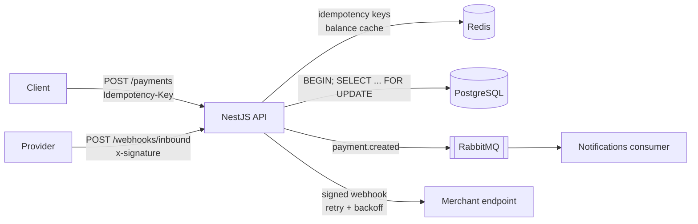

# Payments API

[](https://github.com/Mennaalkholy/payments-api/actions/workflows/ci.yml)

A backend payments service built with **NestJS + TypeScript**, focused on the hard parts of moving money correctly:
idempotent requests, no overdraws under concurrency, cached reads, asynchronous events and signed webhooks.

## Features
- **Accounts & transactions** — PostgreSQL via Prisma; amounts stored as integer minor units (cents).
- **`POST /payments` with `Idempotency-Key`** — keys stored in Redis; retries replay the original response.
- **Row-level locking** — `SELECT … FOR UPDATE` inside a DB transaction prevents overdraw; covered by a concurrency test.
- **Cached balances** — Redis cache-aside with TTL, invalidated on every write.
- **Events** — `payment.created` published to RabbitMQ via `@nestjs/microservices`, consumed by a notifications handler.
- **Webhooks** — inbound HMAC-SHA256 signature verification (timing-safe, with replay window); outgoing signed webhooks with exponential backoff + jitter.
- **Docker Compose** for api, postgres, redis and rabbitmq; **GitHub Actions** CI for lint, unit tests, integration tests and docker build.

## Architecture


### Payment flow
1. Controller requires an `Idempotency-Key`; `SET NX` in Redis claims it atomically.
2. `TransactionsService.debit` opens a DB transaction, locks the account row with `FOR UPDATE`, checks funds, updates the balance and writes a `DEBIT` transaction.
3. The cached balance is invalidated.
4. `payment.created` is published to RabbitMQ and an outgoing signed webhook is dispatched.
5. The response is stored under the idempotency key; retries get the same body with `Idempotent-Replayed: true`.

## API
| Method | Path | Description |
|---|---|---|
| `POST` | `/accounts` | Create account `{ owner, currency? }` |
| `POST` | `/accounts/:id/deposits` | Deposit `{ amount }` (cents) |
| `GET` | `/accounts/:id/balance` | Balance (Redis-cached, `cached` flag in response) |
| `GET` | `/accounts/:id/transactions` | Latest 100 transactions |
| `POST` | `/payments` | Create payment `{ accountId, amount, description? }` — header `Idempotency-Key` required |
| `POST` | `/webhooks/inbound` | Inbound webhook, header `x-signature: t=<ts>,v1=<hmac>` |
| `GET` | `/health` | Liveness |

```bash
curl -X POST localhost:3000/payments \
  -H 'Content-Type: application/json' -H 'Idempotency-Key: 3f2c-order-42' \
  -d '{"accountId":"<uuid>","amount":2500,"description":"Order #42"}'
```

## Running

### With Docker
```bash
docker compose up --build
# API on http://localhost:3000, RabbitMQ UI on http://localhost:15672 (guest/guest)
```

### Locally
```bash
cp .env.example .env            # point at your Postgres / Redis / RabbitMQ
npm install
npx prisma migrate deploy
npm run build && npm start
```

### Tests
```bash
npm test                        # unit tests (no infrastructure needed)
npm run test:integration        # concurrency tests, needs DATABASE_URL + migrations
npm run lint
```

## Design decisions
- **Integer minor units** instead of floats/decimals for money, to avoid rounding errors.
- **Pessimistic locking (`FOR UPDATE`)** over optimistic versioning: contention on a single account is the case that matters, and a short lock gives a simple, provably correct balance check. The integration test races two `80` withdrawals against a `100` balance and asserts exactly one succeeds.
- **Idempotency in Redis with `SET NX`** — atomic claim, `409` for in-flight duplicates, key released on failure so the client can safely retry, TTL bounds storage.
- **Cache-aside with invalidate-on-write** rather than write-through: simpler, and the TTL bounds staleness if an invalidation is ever missed.
- **Raw-body HMAC verification** — signatures are checked against the exact bytes received, compared with `timingSafeEqual`, and timestamps outside a 5-minute window are rejected to stop replays.
- **Exponential backoff with full jitter** for outgoing webhooks; only 5xx/429/network errors are retried.
- **Hybrid Nest app** — one process serves HTTP and consumes RabbitMQ to keep the scaffold small; the consumer can be split into its own service without code changes.

## Roadmap
- Transactional outbox so DB commit and event publish are atomic
- Durable webhook delivery queue with a dead-letter queue
- Authentication (API keys / JWT) and per-merchant webhook secrets
- Transfers between accounts, refunds, and multi-currency
- OpenAPI/Swagger docs and e2e HTTP tests

## License
MIT
